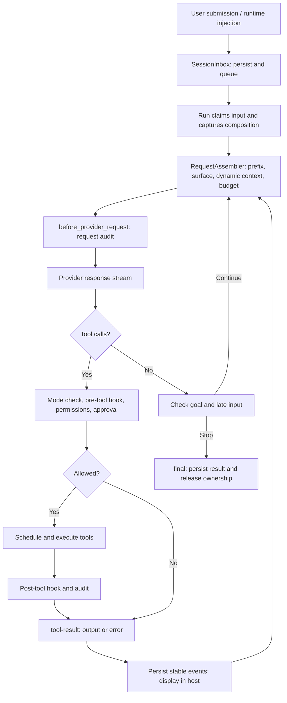

# Cade architecture

Cade is a local Python coding-agent harness. It assembles model requests, executes tools, applies permissions, records sessions, and manages runtime lifecycles. The coding product assembles these capabilities into `CadeApp`. TUI, exec, browser, and Python hosts submit tasks and consume events through the application.

This page describes current component boundaries, execution, state ownership, and extension points. Start with the [README](../README.md) for installation and use. See the [context policy](context-policy.md) for budgets, [configuration](guide/configuration.md) for fields, and [design tradeoffs](design-philosophy.md) for rationale.

## Components and assembly

| Layer | Code | Responsibility |
| --- | --- | --- |
| Provider | [ai/](../src/cade/ai/) | Model protocols, streaming events, usage, and vendor adapters |
| Agent | [agent/](../src/cade/agent/) | Messages, request assembly, model loop, and tool scheduling |
| Harness | [harness/](../src/cade/harness/) | Sessions, run control, permissions, auditing, MCP, and lifecycle services |
| Coding product | [coding_agent/](../src/cade/coding_agent/) | Coding tools, product assembly, shared application services, modes, and commands |
| Host | [coding_agent/modes/](../src/cade/coding_agent/modes/), [server/](../src/cade/server/) | User interaction, event presentation, and host operations |

```text
                       Cade runtime
                            │
             ┌──────────────┼──────────────┐
             │              │              │
            TUI            exec           web
         human UI       automation     browser UI
```

`coding_agent/interaction/` provides shared coding-product application services: commands, completion candidates, file references, skill invocation, model discovery, and statistics snapshots. Commands return results through injected output and selection interfaces. Hosts supply authentication and configuration wizards. Dependencies point from runtime modes and browser hosts to product interaction services, then to product assembly and runtime. Provider, Agent, Harness, and the coding product each own their implementations and lifecycles. Harness owns session storage, approval policies, run control, and event streams.

`coding_agent/modes/tui/` owns `prompt_toolkit`, Rich, terminal layout, folding, reasoning previews, and configuration wizards. `coding_agent/modes/exec_mode.py` consumes runtime events directly for automation. `server/` provides HTTP, WebSocket, and browser presentation through shared interaction and product services. `coding_agent/cli/` handles authentication, configuration, and session subcommands. `main.py` parses arguments and selects a mode. Terminal adapters present selection and configuration wizards. Both `cade` and `cade tui` start the same TUI; use `cade exec` for automation and `cade web` for the browser workspace.

Agent requests models through provider protocols and actions through tool protocols. Harness connects sessions, gates, and runtime services to the loop. The coding product selects tools and policies; hosts manage input and presentation. File tools depend on `FileSystem`, and command tools depend on `Shell`. Production implementations access the local workspace and host processes.

[`build_app()`](../src/cade/coding_agent/app.py) resolves configuration, creates the shared session store, recorder, inbox, History, and cancellation services, then constructs providers, local tools, MCP, Skills, Memory, and the subagent registry. It publishes the composition and returns `CadeApp`. Recorder and inbox share the store. The application owns service shutdown. Hosts supply only explicit session-directory overrides; shared infrastructure assembly chooses configured and default directories.

`AgentComposition` is an immutable configuration generation containing the selected primary provider, frozen tool schemas, `AgentConfig`, static gate policies, the request assembler, and context entry points. The runtime owns the inbox, cancellation, hooks, grant store, and rollover services. A run atomically captures its composition and provider. Later steps use the same snapshot. Replacing models or static permission policies requires an idle agent and publishes a new generation.

`default_provider`, `default_model`, and `default_reasoning_effort` select the default model. `provider.connections` stores connection parameters separately. `~/.cade/auth.json` stores API keys and OAuth credentials by provider. Configuration discovery merges and validates settings without reading authentication or changing models based on login status. Product `assembly/providers.py` expands model roles, resolves the selected providers' credentials, and builds runtime-only provider configuration. Login writes authentication only; setup and configuration editing select defaults.

## Input, execution, and completion

A session identifies a persistent conversation and its active branch. A run identifies one execution that owns that session. Within a runtime, a session has at most one active run. Queued input remains in the inbox. A user turn is one task input and its response process; the TUI records file snapshots at that boundary.

A step is one Agent loop iteration: model output, optional tool execution, and a continuation decision. Retries or output continuation can produce multiple provider requests in a step. Agent `TurnStart` and `TurnEnd` events occur per step, not per host-recorded user turn.



[`SessionRunController`](../src/cade/harness/agent_runtime/run_control.py) puts `steer` input in the `next_step` lane for the next model boundary of the active run. It puts `followup` in `next_turn` for a later task. `interrupt` queues follow-up input before canceling the current run. Finalization checks late steering and continues when needed. Steering affects future requests only; completed actions retain their results.

Adjacent tools declared `parallel` form concurrent batches bounded by the worker limit. A `sequential` tool occupies its own batch and creates an execution barrier. Timeouts, invalid arguments, and denials return tool errors to the model so the loop can respond.

Normal completion, cancellation, step limits, model call limits, watchdog stops, and provider errors have explicit termination categories. The watchdog limits repeated calls and lack of progress. Cancellation requests that model streaming and tools stop; changes already made to files or external services require subsequent handling.

With a goal configured, an independent judge checks existing messages and tool evidence when the main loop tries to stop. If the condition is unmet, feedback returns to the loop. Goal state stores conditions, pause status, and acceptance attempts, with limits on repeated checks. Impossible goals, unavailable acceptance, and exhausted attempts produce distinct notices. A normal `completed` result means the loop ended normally; evidence and goal acceptance establish task success.

The harness records model-history facts synchronously through configured session hooks before delivering events to hosts. Direct harness callers must configure these hooks for pre-send durability. `CadeApp` also records final run metadata. Application shutdown cancels and waits for subagents, releases children, and then closes shared dependencies such as MCP. A child wait timeout interrupts shutdown and retains its dependencies.

## Requests and context

[`RequestAssembler`](../src/cade/agent/request.py) combines the runtime system prefix, current session surface, dynamic context blocks, tool schemas, and options into `RequestAssembly`. The provider and pre-send audit consume the same assembly. Goal judges and automatic approval reviewers have separate model-call paths and service-owned request boundaries.

User input, steering, and explicit runtime injections pass through the inbox. `request_prefix` supplies the system prefix. Context entry points recollect project instructions, NOTE, verification facts, skill catalogs, and runtime state for every request. A section returns complete dynamic blocks with sources, injection targets, ordering priorities, and audit information. Sections select content; the assembler injects selected blocks in full and reclaims history and tool evidence to meet budgets. Changed factual user-context snapshots enter history as `ContextMessage` values, rather than disappearing before the next response is replayed.

API schemas declare tool names, descriptions, and parameters. Prefix tool guidance uses the same enabled tool set as the schema for that request. Read-only side questions do not receive tool guidance.

`ContextManager` owns session history, input usage anchors, and the last rollover reason, including for standalone Agent calls. `ContextPolicy` subtracts output reserve and safety margin from the model's physical window and budgets input, tool evidence, and new messages. Prediction uses successful provider input usage plus estimated local differences, or local estimates when the anchor is invalid. Providers report actual usage; request projections control admission and early rollover.

Large tool results become previews with recovery references in requests. Complete results remain in transcripts or artifacts and are restored before request projection. The latest successful durable state for a `context_key` is protected; older versions become history indexes. If required context exceeds the safe input budget, assembly fails explicitly with `context_error` instead of sending an incomplete request. Rollover also requires reclaimable history. Model window size and required input bound the policy's effective range.

Automatic rollover retains the current user request, persistent state, and bounded recent complete interactions. It recollects NOTE, verification facts, and runtime state and records a surface replacement in the session. Original window content remains available through `history`. Later tasks must retrieve reclaimed evidence by reference. NOTE completeness affects continuity. See the [context policy](context-policy.md) for formulas, trimming order, and observations.

## State ownership and recovery

| Object | Owner and storage | Lifecycle and purpose |
| --- | --- | --- |
| Transcript and artifacts | Session store; `.cade/sessions/` and `.cade/session_artifacts/` by default | Append session facts and complete tool content for replay and branching |
| Inbox | `SessionInbox`, using the same store | Persist pending input and inserted/claimed/discarded lifecycle |
| Surface | Session replay and active run | Replayable branch history, replaced on rollover |
| RequestAssembly | Request assembler, per request | Final wire messages, tools, options, budget, and source trace |
| Composition | Harness, in-process snapshot | Run configuration linked to requests by generation ID |
| Active run, cancellation, and connections | Run controller, providers, MCP, and runtime services | In-process resources reestablished after recovery |
| NOTE.md | Workspace file read by NotesCollector | Task progress, validation, and handoff; rollover can snapshot it |
| Memory | Markdown in workspace `.cade/memory/` | Verifiable cross-session knowledge read when needed |
| File snapshots | SnapshotStore; `.cade/snapshots/` by default | TUI user-turn changes and undo evidence |

[`replay_session()`](../src/cade/harness/session/replay.py) rebuilds messages, run metadata, goal, and context state for the active branch. Inbox replay rebuilds pending input. Recovered runs issue new requests using current assembled services. Hosts reestablish tools, connections, and active tasks from the old process. Tool side effects and event recording are separate operations; if the process exits between them, recovery must check workspace and external state.

Session records distinguish final user-visible `assistant` entries from model responses and events such as `tool_use`, `tool_result`, `runtime_context`, and `final`. `provider_request` stores the request fingerprint, size, parameters, composition ID, and trace. `final` stores the answer, counters, termination details, and recovery metadata. Existing semantic events reconstruct messages and tool arguments.

`context_window_reset` stores a typed replacement, source entry IDs, and an increasing generation. Replay checks that sources belong to the current branch prefix, validates message structure and tool pairing, and replaces the surface in log order. The original transcript remains. See the [context policy](context-policy.md) for validation scope and request fingerprints.

`fork` retains history before a selected user input, passes that input to the host editor, and switches to a new session. Rollover records retain complete prefix sources and replacements; snapshots correspond to retained completed tasks. `clone` copies the complete log and snapshots and switches to the copy. Both share current workspace files. `rewind` moves the active branch head and removes later snapshot records.

`undo` restores user-turn file snapshots after checking conflicts against the turn's ending state and applying write permissions. It restores changed or deleted files and removes added files. Per-file results support partial completion; a fully restored turn is marked undone. Snapshots use an independent Git object store, require a Git project, and have size and exclusion limits. See [Sessions](guide/sessions.md) for operations and history pagination.

The user or model maintains NOTE. If it differs from a rollover snapshot on recovery, the runtime supplies the old snapshot and a verification notice; later operations reconcile the file. Memory stores sourced knowledge for ordinary file search and reading. See [Cade's Memory](guide/memory.md) for saving and evidence boundaries.

## Modes, permissions, and execution environment

[`ExecutionModeState`](../src/cade/coding_agent/execution_modes.py) manages tool visibility, mode rules, and approval routing. [`ToolGate`](../src/cade/harness/agent_runtime/tool_gate.py) applies them to calls. Modes change only through explicit selection; Plan never exits based on the number of tool calls or model steps. The table describes built-in rules; configured rules and path boundaries also affect decisions.

| Mode | Structured file writes | Shell | Default approval route |
| --- | --- | --- | --- |
| Plan | Plan files and `NOTE.md` allowed; project code restricted | Read-only allowed, known mutations denied, unknown effects ask | Automatic reviewer |
| Build | Allowed within the workspace by default | Read-only allowed; mutations and unknown effects ask | Automatic reviewer |
| Act | Ask by default | Read-only allowed; mutations and unknown effects ask | User |

The gate first checks mode eligibility, then runs the pre-tool hook. Hooks can rewrite arguments or add constraints. The permission engine extracts an `Action` from actual arguments and combines path boundaries, static policies, shell analysis, and rules. User rules precede mode defaults and use first-match selection. The resolver combines other constraints with `deny > ask > allow` precedence.

`deny` stops a call. `allow` executes it. `ask` checks existing session/permanent grants before requesting user or reviewer approval under the approval policy. `never` denies new approval requests. Automatic review grants only the current call. User grant scope depends on the action's supported once/session/permanent scopes. Post-tool hooks connect permission, result, and audit records. Observability uses session, turn, request, and tool-call identifiers; requests also store composition IDs.

Approval controls whether an action can start; the execution environment limits what it can access. On Linux, Agent `bash` uses `LinuxBubblewrapSandbox` by default. `workspace-write` mounts the host root read-only and permits the workspace, temporary directories, and approved external write directories. Project `.git`, `.agents`, and `.cade` stay read-only. Credentials and environment files are masked; networking follows configuration. Default sandbox assembly requires `bwrap` and fails initialization if it is missing.

OS sandboxing currently covers Linux Agent Shell with mount, network, PID namespace, and capability isolation. Structured file tools use path boundaries. Shells on other platforms use local processes. Trusted hooks and MCP servers run outside this shell sandbox with host-controlled process permissions. Network isolation applies to the Agent Shell namespace. Bubblewrap syscall seccomp is currently disabled.

## Extensions and lifecycle

Provider adapters convert vendor responses to common text, tool call, usage, finish, and failure events through the [provider protocol](../src/cade/ai/providers/base.py). Transport runtimes handle transient network errors and rate-limit retries. Agent handles step retries against the selected provider, output continuation, and context overflow recovery. Cade never automatically switches models after a request failure.

The MCP registry discovers tools at startup or reads a source-valid schema cache. Tools become `ToolSpec` entries behind the shared gate; persistent connections open on first use. `tools/list_changed` updates discovery cache and diagnostics. The current application keeps its startup tool snapshot; restart after editing MCP configuration. MCP tools and resources come from external processes. The gate controls calls; configure process isolation on the host.

The Skills registry captures definitions during discovery and publishes summaries. `load_skill` injects full content on demand. Session messages preserve loaded skill state for recovery. `trust_project_skills` controls project skills. Skill instructions guide model choices; execution still passes through the gate.

External hooks are configuration-authorized host commands. `ExternalHookRunner` handles matching, timeouts, failure policies, and subagent inheritance. Pre-tool argument rewrites precede permission decisions, and constraints can only tighten execution. Internal hooks record requests and runtime audits.

Tools return `ToolRenderIntent` with terminal, diff, location, or subagent semantics. Typed results persist intents so hosts can restore presentation. Tools own execution and result descriptions; TUI and browser adapters own layout and interaction.

## Subagents

`delegate` without `session_id` creates an independent persistent child session. With an ID and prompt, it submits a follow-up to an existing continuable child. New context comes from a self-contained task prompt. Parallel batches use one-shot mode; sessions requiring continuation use continuable mode.

Each child owns its transcript, surface, inbox, and composition. A descriptor records the direct parent, mode, persona, model, and initial capabilities. Persistent session ID, in-process activation ID, and run ID identify different lifecycles. Cold recovery rebuilds the surface from the log and intersects the original tool set with the current registry before requesting the model for subsequent tasks.

The direct parent controls continuation, interruption, and release. Release reclaims an idle activation but retains the persistent session. One-shot children release automatically; continuable children can be materialized again. Child gates derive from the parent permission domain, and parent cancellation propagates. The current registry supports at most one delegation level. `subagent_run` lifecycle events and tool results link status, summaries, and errors to the parent.

## Code entry points

| Change | Main location | Related contracts |
| --- | --- | --- |
| Model integration or stream handling | [ai/providers/](../src/cade/ai/providers/), [ai/events.py](../src/cade/ai/events.py) | Provider protocol, usage, failure classification |
| Loop or tool scheduling | [agent_loop.py](../src/cade/agent/agent_loop.py), [_execution.py](../src/cade/agent/_execution.py) | Steps, termination, barriers, cancellation |
| Request content and budgets | [request.py](../src/cade/agent/request.py), [context_policy.py](../src/cade/agent/context_policy.py) | Assembly, trace, rollover, history recovery |
| Runs and input scheduling | [harness.py](../src/cade/harness/agent_runtime/harness.py), [run_control.py](../src/cade/harness/agent_runtime/run_control.py) | Ownership, inbox, composition |
| Persistent state | [session/](../src/cade/harness/session/) | Event encoding, surface, replay |
| Permissions or sandbox | [security/](../src/cade/harness/security/), [execution_env/](../src/cade/harness/execution_env/) | Action, resolver, grants, path boundaries |
| Coding tools | [coding_agent/tools/](../src/cade/coding_agent/tools/), [assembly/registry.py](../src/cade/coding_agent/assembly/registry.py) | Schemas, permission actions, execution mode, render intents |
| Dynamic context | [assembly/agent.py](../src/cade/coding_agent/assembly/agent.py), [context.py](../src/cade/agent/context.py) | Sources, priorities, lifecycles, budgets |
| Extension discovery and connections | [mcp/](../src/cade/harness/mcp/), [skills/](../src/cade/harness/skills/) | Tool snapshots, lazy connections, activation, shutdown |
| Hooks and audits | [observability/](../src/cade/harness/observability/) | Argument rewriting, correlation IDs, failure policies |
| Subagents | [subagents.py](../src/cade/harness/agent_runtime/subagents.py) | Descriptors, cold recovery, inherited permissions, shutdown |
| Interaction and presentation | [coding_agent/modes/](../src/cade/coding_agent/modes/), [server/](../src/cade/server/) | Typed events, application lifecycle |

See the [validation guidelines](testing.md) for behavior checks and commands, [AGENTS.md](../AGENTS.md) for interface migrations and engineering rules, and the [development guide](development.md) for setup, commits, and releases.
