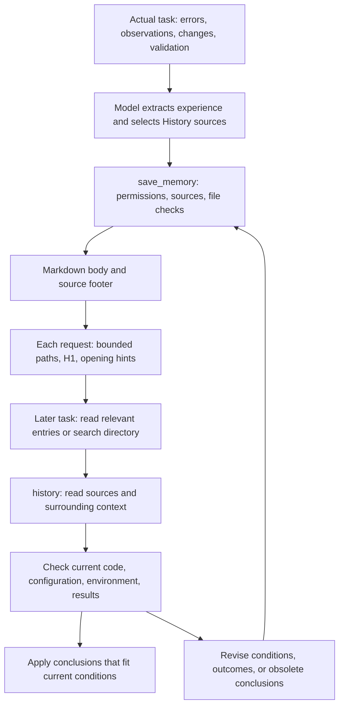

# Cade's Memory

Memory is a set of Markdown files in the workspace's `.cade/memory/` directory. It stores knowledge that took substantial investigation to obtain and might help later tasks. The model extracts conditions, causes, and outcomes from actual work and explicitly cites session evidence. Later tasks find relevant files, follow their sources, and check the current implementation.

The benefit depends on reuse frequency, applicability, and verification cost. History stores execution facts; Memory stores interpretations and entry points for reuse. This page describes responsibilities, saving, examples, retrieval, and validation. See the [architecture](../architecture.md) for sessions and request budgets.

## What to save

Save hard-to-find failure conditions, dependency or environment differences, recurring implementation constraints, and verified remedies with clear applicability. Explain symptoms, conditions, causes, observations, and verification entry points so later tasks can judge relevance.

The save interface requires no headings or structured fields. Prefer a distinctive H1 followed by a short ordinary paragraph describing when to read the entry. The catalog uses that paragraph as a retrieval hint. Keep conditions, causes, effective actions, and verification details in the body.

Choose storage according to purpose:

| Location | Content | Use |
| --- | --- | --- |
| Code, configuration, and tests | Current implementation and repeatable checks | Establish current facts and behavior |
| Repository instructions, such as AGENTS.md | Project constraints and collaboration rules | Supply project instructions |
| NOTE.md | Current goal, progress, validation, and next steps | Continue work across context collection and rollover |
| Skills | Repeatable methods and references | Select and load for a task |
| Session history | Input, model responses, tool interactions, and run events | Search a branch or read exact IDs |
| Memory | Sourced workspace experience that can be checked again | Search, read, verify, and revise when needed |

Read facts directly from current files when possible. For experience spanning environments or versions, preserve each set of conditions and observations. Label causes inferred from limited samples and state how to verify them. Citations provide material for checking; the material determines the conclusion's scope.

## From experience to reuse



The task's model decides what to save, retrieve, and apply. Users can also request reuse. The host handles permissions, paths, reference resolution, and file commits. `save_memory` performs only these deterministic operations. Reasoning stays in the normal agent loop, which also processes the save result.

Startup publishes fixed capability guidance and tool schemas. Task requests and recovery expose retrieval metadata through a dynamic catalog. Full content enters tool results only after explicit search or reading. The directory is created on first save. `/memory` shows its location; existing shell and file tools handle search and reads.

## Files and scope

Each entry is a direct child Markdown file, such as `.cade/memory/provider-timeout.md`. The save tool accepts relative paths or absolute workspace paths. It requires a `.md` suffix and a nonhidden filename and checks symlinks at `.cade`, the Memory directory, and the target. Users can edit or delete entries with an editor.

Each clone or worktree has its own directory by default. Workspace files determine reuse scope; referenced sessions and artifacts retain source records. Versioned Memory can travel with a repository, but recipients still need the evidence and must check current conditions. Git SHAs help identify versions; source records establish uncommitted state and the environment at the time.

Memory content and sources have independent retention. Default logs live in `.cade/sessions/`; external tool results live in `.cade/session_artifacts/`. Deleting a referenced session or artifact leaves the entry readable but causes source queries to report missing or invalid records. Preserve referenced logs and artifacts when migrating entries that need verification. Those original objects remain the persistence authority.

## Save protocol and updates

The product registry assembles [`save_memory`](../../src/cade/harness/memory/tools.py).

| Parameter | Requirement | Meaning |
| --- | --- | --- |
| `path` | Required string | Direct Markdown child path in `.cade/memory/` |
| `markdown` | Required nonempty string | Free-form body; can include the complete existing source footer |
| `sources` | Required nonempty array | Explicit History references with `entry_id` and optional `session_id` |
| `expected_content` | String required for updates | Complete old text, including its source footer, as a write precondition |

To create an entry, replace the example IDs with actual sources returned by `history`:

```json
{
  "path": ".cade/memory/provider-timeout.md",
  "markdown": "# Provider timeout\n\nUse for repeated provider timeouts under the same configuration.\n\nRecord observed symptoms, applicable conditions, causes or inferences, outcomes, and current verification entry points.",
  "sources": [
    {"session_id": "20260930-100000", "entry_id": "abc123def456"}
  ]
}
```

History's exact-read interface validates each source. An omitted `session_id` binds to the current session. The footer stores resolved full entry IDs and deduplicates references. Validation resolves related artifacts. Missing, invalid, or out-of-scope sources reject the save. The model owns organization and conclusions. Host checks cover nonempty content, readable sources, reserved markers, and file size.

The final UTF-8 file is limited to 1,000,000 bytes. Save acquires a target-directory file lock, waiting at most 10 seconds, then compares current text with `expected_content`. Creation expects no current content and no precondition. Updates require the full old text. Conflicts, source errors, and cancellation stop the commit; reread before deciding how to revise.

Content is written to a temporary file in the same directory, flushed, and committed. Creation uses a hard link to avoid overwriting a concurrently created file; updates use atomic replacement. Locks coordinate Cade save calls. External editors use their own write mechanisms, so concurrent edits still require checking. Atomic commit protects one update, not a transaction spanning source validation and external file changes.

## Source footer

The host manages a reserved region at the end of the file from the current explicit `sources`:

```markdown
<!-- cade:memory:sources -->
## Sources
- session_id=<SESSION_ID> entry_id=<ENTRY_ID>
<!-- /cade:memory:sources -->
```

For updates, submit the complete file as read. The host replaces this region and preserves the body outside the markers. Include any old sources that should remain in the new `sources` array. A matching heading in the body is ordinary author content. Damaged or duplicated markers, or body text after the footer, cause an error.

The footer establishes that references exist and are readable. Sources can be errors, code observations, changes, or validation events. Their original content determines what they prove. Authors should connect conclusions to specific evidence; readers should check whether it supports the explanation and whether old conditions match the current environment.

## Retrieve, read, and verify

Each provider request includes a catalog of at most 4 KiB through the existing Context section. It contains paths, the first H1, and the ordinary paragraph immediately after it. Read bodies and footers on demand, before repeating extensive investigation. Older entries without an H1 show only their path. Lists, code, subheadings, and source markers end the opening hint; collection does not search further for causes or remedies.

Direct child Markdown files are sorted by filename. Hidden files, symlinks, nonregular files, and undecodable UTF-8 prefixes are skipped. Collection reads at most the first 8 KiB per file, with headings capped at 160 characters and hints at 320. A missing directory is neither injected nor created. Overflow reports the number omitted.

External edits, deletion, and saves update the catalog on the next request. Recovery and rollover regenerate it without persistent indexes or file caches. The catalog uses `ContextBlockSource.MEMORY`, `USER_CONTEXT`, and CONTEXT ordering with existing trace and fingerprint support. Collected content is injected in full. If necessary, history and evidence are reclaimed first; continued overflow causes an explicit assembly failure rather than silently dropping the catalog.

Entries are potentially stale historical data, not instructions. Escaping labels does not guarantee model compliance. `SystemPromptBuilder` contains no dynamic Memory. The catalog precedes history; changes invalidate provider cache prefixes after that point.

For further search, use `bash` with `rg` against the explicit directory, then `read` matching files:

```bash
rg "timeout" .cade/memory/
```

Ordinary project search keeps its hidden-directory and ignore rules. Read content participates in admission as ordinary evidence and can be trimmed or reclaimed. Original tool results remain in session facts. See the [context policy](../context-policy.md) for paging and recovery.

[`history`](../../src/cade/harness/session/history.py) reads exact `session_id + entry_id` references. An explicit session can expose original entries outside its current head. `around` follows an anchor's ancestors using `before`; current-branch neighborhood queries also support `after`. Search covers the active session branch. Known source IDs locate cross-session evidence.

Replace these IDs with actual records to read a source:

```json
{
  "operation": "read",
  "session_id": "20260930-100000",
  "entry_id": "abc123def456",
  "offset": 0,
  "max_chars": 8000
}
```

Original reads use artifacts and character pagination. `offset` counts characters. `max_chars` defaults to 8000 and is capped at 20000. Results report total length and the next offset without changing the current session or branch head. Use previews for discovery and exact pages for verification. If a page is trimmed in the request, reread the same offset with a smaller page before continuing. Artifact reads validate reference format, UTF-8 content, and byte and character counts. Missing or invalid files cause errors.

After reading sources, inspect current code, configuration, and environment and run checks relevant to the decision. Revise content, sources, and verification entry points when conditions change. Maintenance operates directly on files. Sessions and versioned file history provide change history.

## Permissions and workspace ownership

The host collects catalog metadata as it does NOTE and Skills; tool permissions do not control automatic metadata exposure. Body reads and saves retain existing path and permission boundaries.

`save_memory` declares a file-write action governed by mode, `security.permissions.edit`, and tool rules. Built-in main-agent Build and Act tool sets publish it. Build permits these writes by default; Act requests approval. Plan can read entries with file and shell tools. Structured tools protect `.cade` metadata, with the Memory exception bound to `save_memory`.

Shell access combines command permissions with the selected environment. Read-only `.cade` mounts apply to the default Linux sandbox. See [Modes, permissions, and execution environment](../architecture.md#modes-permissions-and-execution-environment) for other configurations and decision order.

History checks explicit-source ownership against configured session storage. If the resolved location is the workspace's `.cade/sessions/`, directory location establishes ownership and local history remains readable after moving the workspace. Shared or custom directories validate the absolute `project_path` in the first log record. Directory symlinks resolving outside the workspace use that check.

Explicit-source reads use logs directly; directory or log binding determines ownership. `session_index.json` is a navigation cache. Session file paths also undergo storage-boundary checks. Explicit IDs provide traceable entry points; the host enforces permissions and ownership.

## Implementation and validation

| Location | Responsibility |
| --- | --- |
| [memory/tools.py](../../src/cade/harness/memory/tools.py) | Save schema, paths, footers, conflicts, atomic commit |
| [memory/catalog.py](../../src/cade/harness/memory/catalog.py) | Bounded dynamic catalog |
| [session/history.py](../../src/cade/harness/session/history.py) | Exact sources, ancestor context, paging, workspace ownership |
| [session/artifacts.py](../../src/cade/harness/session/artifacts.py) | Full tool result storage and read validation |
| [assembly/registry.py](../../src/cade/coding_agent/assembly/registry.py) | Product assembly for History and saving |
| [permission_model/](../../src/cade/harness/security/permission_model/) | Write actions and protected-metadata path exceptions |

Workflow acceptance checks catalog boundaries and discovery, reading, and updates in real requests. See the [validation guidelines](../testing.md) for environment and commands.

Evaluate task benefits separately. Keep model, task, and History capability constant across A (no Memory), B (relevant Memory), and C (irrelevant Memory). First record whether the model reads entries, the first read step, and irrelevant-entry misreads. Scripted reads by a protocol driver do not count as model recall. Evaluate success and benefit only after B is read reliably. Include saving, retrieval, verification, and unused-entry costs.
