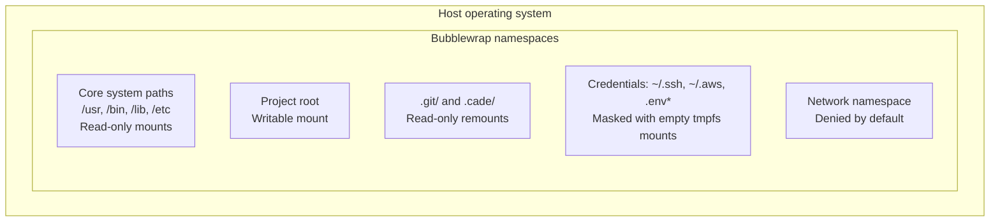

# Permissions and Linux sandboxing

Cade can execute shell commands and modify local files. It combines permission decisions, operation review, and Linux sandboxing to limit those capabilities. These controls reduce risk; they are not a guarantee against every malicious prompt or command.

## Linux bubblewrap sandbox

On Linux, the default configuration requires bubblewrap (`bwrap`) to launch an isolated process. If it is missing, application assembly fails instead of falling back to unsandboxed execution. Install it before starting Cade, for example with `sudo apt install bubblewrap` on Debian or Ubuntu.

Linux bypasses bubblewrap only when `security.sandbox.mode` is `danger-full-access` and `security.sandbox.network_access` is `allow`. Other combinations still require bubblewrap. Non-Linux platforms use local subprocess execution.

The default sandbox has these boundaries:

### Sandbox controls

1. Core host paths such as `/bin`, `/usr`, and `/etc` are read-only inside the sandbox.
2. The project root is writable, but `.git/` and `.cade/` are remounted read-only to protect repository metadata and Cade configuration.
3. Sensitive directories such as `~/.ssh/`, `~/.aws/`, `~/.gnupg/`, and `~/.config/gcloud/` are masked with empty tmpfs mounts. Workspace secret files such as `.env` and `.env.local` are also masked from sandboxed shell access.
4. Network access is denied by default. If a task needs network access, such as downloading test dependencies, configure `network_access: "allow"`.

These controls describe sandboxed shell execution. See the [architecture](../architecture.md#modes-permissions-and-execution-environment) for structured file tools and external services.

## Permission decisions

Tool calls pass through the permission engine:

- `allow`: execute directly, such as a project file edit in Build mode.
- `ask`: request approval for the proposed operation and arguments.
- `deny`: block the operation and return an error to the model, such as a Python source edit in Plan mode.

## Automatic reviewer

Build mode uses an independent reviewer for shell operations that require review. Rule matching handles recognized commands first. Commands with unknown effects receive a model-based safety assessment. High-risk operations, such as disk formatting, system service changes, or data disclosure, can be denied or routed to the user for approval.
