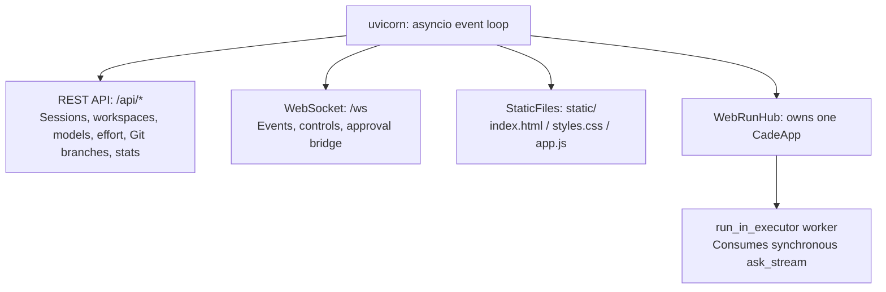

# Browser workspace

## Purpose

`cade web` runs a single-process FastAPI service and a vanilla JavaScript single-page application with no build step. It shares assembly, session logs, and execution semantics with CLI/TUI. The browser projects typed harness events into steps, reasoning, tool cards, and approval dialogs.

```sh
cade web              # 默认 http://127.0.0.1:8787
cade web --open       # 启动后打开浏览器
cade web --port 9000
```

## Access control

Open the private URL printed by `cade web`, or use `cade web --open`. Each server
start generates a new access token. Treat the URL as a credential. Its fragment
is not sent to the server; the frontend removes it from the address bar and stores
the token in the tab's session storage. After a restart, open the new URL.

REST API requests require `Authorization: Bearer <token>`. WebSocket clients must
send the subprotocols `cade` and `<token>`; the server selects only `cade`.
WebSocket handshakes and state-changing HTTP requests also require a trusted
`Origin`. All requests require a trusted `Host`, including the configured port.
Missing, duplicate, `null`, and untrusted origins are rejected where an origin
is required. A token does not bypass these checks.

Loopback and wildcard binds trust only `127.0.0.1`, `localhost`, and `[::1]` at
the configured port. For remote access, bind to an explicit address with `--host`;
only that address is trusted. Forwarded headers do not change this policy.
Arbitrary reverse-proxy origins are not supported. HTTP does not encrypt the
credential or agent traffic; keep the service on a trusted network or use an
SSH tunnel to its loopback address.

## Process model



The process owns one `CadeApp`, as the TUI does. Browser tabs share its event stream; sessions do not run concurrently.

The synchronous `ask_stream` iterator runs in `run_in_executor` so model warmup and other blocking work do not stall WebSocket heartbeats. Cancellation passes through `CancellationToken`.

A tool thread's synchronous `user_approval_callback` waits on a `threading.Event` for a browser decision. The 300-second timeout denies the request.

## Backend modules

| Module | Responsibility |
| --- | --- |
| `server/serve.py` | Parse `cade web` options such as `--port` and `--open`, assemble `create_app`, and start uvicorn |
| `server/api.py` | Assemble REST/WebSocket routes and static resources; cache model discovery with a 10-second timeout and five-minute TTL |
| `server/runner.py` | `WebRunHub`: submission, broadcasts, session/workspace switching, approval bridging |
| `server/serialize.py` | Convert Pydantic, dataclass, enum, and UUID values to JSON-safe dictionaries and truncate long text |

Workspace switching can rebuild the application through `app_factory` (`build_app`). `hub.set_app` replaces the entire `CadeApp`.

### Shared runtime paths

Web uses existing runtime semantics:

- Recovery uses `store.resume()` and `app.restore_session()`, as TUI `/resume` does. `POST /api/sessions` uses `store.clear` and `restore_session`, matching `/clear`.
- Status uses `_compute_context_summary` and `format_usage_stats`, with the same terminal format: `↑in ↓out R cache CH hit% $cost context% model • effort`.
- Model and effort options use `reasoning_effort_levels_for_transport` and model gateway discovery. Custom transport skips discovery and lists the current model plus a custom-entry control.
- Git branches come from `git for-each-ref refs/heads refs/remotes/origin/`. Switching uses `git switch`; remote branches without a local counterpart use `--track`. Switching during a run returns 409.

## WebSocket protocol

`/ws` uses JSON text frames. Browser-to-server messages:

| Type | Fields | Purpose |
| --- | --- | --- |
| `submit` | `text`, `mode` | Submit a message; restore the session first if waiting on approval |
| `cancel` | None | Cancel the current turn |
| `approval` | `id`, `decision`, `scope` | Return an approval decision |
| `ping` | None | Send a heartbeat |

Server-to-browser types:

```text
hello | user_message | run_started | event | run_idle | run_error
run_cancelled | approval_request | session_reset | session_switched
workspace_switched | pong
```

`event` carries `AgentHarnessEvent` values such as `text_delta`, `reasoning_delta`, `tool_use`, `tool_result`, `assistant`, `context_window_reset`, and `final`. The UI groups rendering by `step`, matching TUI event semantics.

## REST API

| Endpoint | Method | Purpose |
| --- | --- | --- |
| `/api/info` | GET | Project path, session ID, current branch, model, effort, available models, thinking |
| `/api/stats` | GET | Usage and context summary for status updates |
| `/api/model` | GET/POST | Read or switch model with `{model, effort?}`; reject during a run |
| `/api/sessions` | GET/POST | List or create sessions |
| `/api/sessions/resume` | POST | Resume a session with `{id}` |
| `/api/sessions/{id}` | GET | Replay one session, bounded by `_SESSION_TRANSCRIPT_LIMIT` |
| `/api/workspaces` | GET/POST | List or switch workspace with `{path}`; persist recent paths in `~/.cade/web_workspaces.json` |
| `/api/git/branches` | GET/POST | List local/remote branches or switch with `{name}` |
| `/ws` | WS | Live events and controls |

## Frontend

`static/` contains HTML, CSS, and one IIFE-based `app.js`. It uses no framework or build step.

- Text updates are throttled through `requestAnimationFrame`. Steps and tool cards append nodes instead of rerendering the whole page.
- A small internal Markdown renderer escapes content, then handles code blocks, inline code, and bold text without a parser dependency.
- Model, effort, Git branch, and workspace controls share `.drop`: a button and fixed-position menu with outside-click dismissal, trigger-width sizing, and overflow ellipsis.
- The session view switches between a new-conversation empty state and history. Opening history resumes the session rather than displaying a read-only preview.
- CSS variables such as `--ink`, `--panel`, `--amber`, and `--olive` define the palette. The UI uses monospace fonts, themed scrollbars, a layout breakpoint below 960 px, and `prefers-reduced-motion` handling.
- Static resources use `no-store` to avoid stale JavaScript referencing removed DOM nodes.

## Development and validation

```sh
uv run cade web --port 8791                       # 启动本地服务
uv run pytest src/cade/tests/test_server_web.py -q # 检查序列化和 API 契约
uv run ruff check src/                            # 检查 lint
uv run pyright src/cade/server/                   # 检查类型
node --check src/cade/server/static/app.js         # 检查 JS 语法
```

Refresh the browser after static changes; no build is required. Restart the service after backend changes. On Windows, stop the process holding the port before restarting.

## Known boundaries

- One server owns one session/workspace application; it cannot run two workspaces concurrently.
- Switching workspaces uses the target directory's `cade.config.json` and does not inherit the CLI `--config` override.
- Under custom transport, switching models removes the old model from the list; use the add control to return to it.
- Approval dialogs require real `approval_request` events from Act-mode tools. End-to-end validation needs an actual approval-triggering call.
